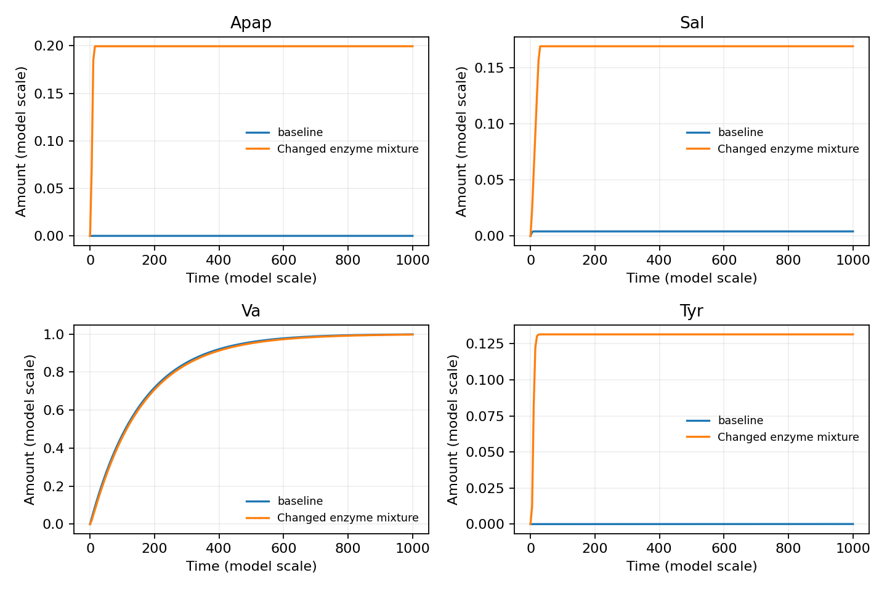

# Enzyme Cascade Design

Build kinetic models of multi-enzyme cascades and explore how enzyme mixtures
change product formation. The toolkit connects a reaction network to editable
kinetic inputs, Julia simulations and comparisons of proposed enzyme changes.

**reaction network → kinetic assignments → simulation → design comparisons**

Version **0.1.0**. Distributed under the MIT licence.

- Assign a rate law and constants to each reaction while keeping the network
  stoichiometry in one place.
- Compare individual enzyme changes, named mixtures or combinations of factors.
- Inspect product trajectories, remaining intermediates and numerical checks.

The examples include an aromatic cascade producing paracetamol, salicylate,
vanillate and tyrosine (**9MEC**), a **3-hydroxypropionate (3HP)** reaction network,
and small Michaelis–Menten models for learning the input formats.

## Start with the results

Only **Python 3.11 or later** is needed to inspect the supplied results:

```sh
git clone --branch v0.1.0 https://github.com/tacsy-tools/enzyme-cascade-design.git
cd enzyme-cascade-design/code

# A 3 × 3 table: exact pyruvate inputs / exact 3HP outputs.
python3 show.py matrix results/pathways/queries/3hp

# One pathway, with reaction multiplicities and carbon counts.
python3 show.py pathway results/pathways/queries/3hp/pyr2-3hp1.json

# Reference and changed enzyme mixture for 9MEC.
python3 show.py endpoints results/design-walkthrough
```

The last command compares the reference mixture with four branchpoint changes:

| Enzyme mixture | Apap | Sal | Va | Tyr |
| --- | ---: | ---: | ---: | ---: |
| Reference | 0.000141 | 0.004083 | 0.998190 | 0.000068 |
| Four branchpoint changes | 0.199530 | 0.168956 | 0.997107 | 0.131514 |

Apap is paracetamol, Sal salicylate, Va vanillate and Tyr tyrosine. Amounts use
the supplied model scale at its endpoint, **t = 1000**. The changed mixture uses
ODO 0.001×, GBH 2.5×, LCH 100× and PABB 100×; all other inputs stay fixed.



## Run a design comparison

Use **Julia 1.11.x**; the pinned environment was tested with **1.11.5**.
With [Juliaup](https://github.com/JuliaLang/juliaup), select that version for the
`code/` directory, then install the dependencies:

```sh
juliaup add 1.11.5
juliaup override set 1.11.5
julia --version
julia --project=. -e 'using Pkg; Pkg.instantiate()'
```

The directory override also applies to Julia started by the Python scripts.
If Julia is installed manually, ensure `julia` on your `PATH` is version 1.11.x.
The pinned package versions are not supported on Julia 1.12 or 1.13; the scripts
check the runtime before loading packages or creating run outputs.

For optional Python plotting packages, first create an environment:

```sh
python3 -m venv .venv
source .venv/bin/activate
```

Then rerun the reference and the four-branchpoint intervention:

```sh
python3 scan.py examples/9mec/model.json \
  --vary ODO=0.001 --vary GBH=2.5 --vary LCH=100 --vary PABB=100 \
  --pool Atp,Adp,Amp --pool Nadh,Nad_plus --pool Sam,Sah \
  --output results/local/design --run
python3 show.py endpoints results/local/design
```

Each run records its inputs, applied enzyme factors, trajectories, endpoint
amounts and numerical checks. Output directories must be empty, so a new
calculation cannot silently replace an earlier one.

To plot the four product trajectories, install `requirements-figures.txt` and run:

```sh
python3 -m pip install -r requirements-figures.txt
python3 plot.py results/local/design --output results/local/design.png
```

For a single-enzyme scan, replace the four `--vary` options with `--single 2 5`.
For combinations, use e.g. `--vary ODO=1,0.5,0.2 --vary SDH=1,5`.

## From a network to an editable model

The network supplies the species and reaction stoichiometries. Kinetic laws,
constants and initial pools are assigned separately:

```sh
python3 kinetics.py init examples/9mec/network/network.json results/local/kinetics \
  --import-kinetics examples/9mec/kinetic-reference.json

# Edit kinetics.csv, initial.csv and settings.json in results/local/kinetics/.

python3 kinetics.py build examples/9mec/network/network.json \
  results/local/kinetics results/local/model.json
```

Unknown kinetic assignments remain blank and must be completed before building.
Imports match reactions by their stoichiometry; network hashes prevent silently
reusing assignments after the network changes.

## Reproduce and check

All commands below run inside `code/`:

```sh
python3 -m unittest discover -s tests -v
python3 audit_results.py
python3 reproduce.py --kinetics --output results/local/kinetics-batch
python3 verify.py --output results/local/verification
```

The kinetic batch includes 50 9MEC cases and the small kinetic tutorials.
`verify.py` checks independent rate calculations and agreement with the supplied
9MEC reference model. The [verification record](docs/verification.md) describes
the checks performed on this repository.

## What is here

| Location | Contents |
| --- | --- |
| [`code/`](code/) | Python and Julia scripts, pinned Julia environment |
| [`code/examples/`](code/examples/) | 3HP, 9MEC and Michaelis–Menten inputs; native DG and SBML exports |
| [`code/results/`](code/results/) | Current example tables and selected trajectories |
| [`code/tests/`](code/tests/) | Input validation, reaction matching and network checks |
| [`docs/usage.md`](docs/usage.md) | Further commands and interpretation |
| [`docs/credits.md`](docs/credits.md) | Attribution and supporting-method reference |

MØD is needed only to rebuild a reaction network; it is unnecessary for reading
saved results or running kinetic models.
Rebuilding also requires `requirements-export.txt`. No web service is required.

## Models and results

Example models provide a starting point for comparing cascade designs. Kinetic
inputs and their experimental interpretation can be refined without changing the
workflow. The supplied batch models use finite initial pools; compare results
under the same initial conditions and observation interval.

Saved pathway and carbon-accounting records can be inspected with `show.py`.
Their input/output specifications and feed policies are recorded with each result.
This repository provides the result viewer; it does not calculate new pathway
optimizations.

## Project and citation

Developed within [TACsy](https://tacsy.eu/), the **Training Alliance for
Computational Systems Chemistry**, a Marie-Skłodowska-Curie Doctoral Network.
The work supports TACsy's research on computational methods for enzymatic
synthesis design. See [credits](docs/credits.md) for attribution and method
references, and [CITATION.cff](CITATION.cff) for citation information.

Distributed under the [MIT licence](LICENSE). External runtimes retain their own
licences.
